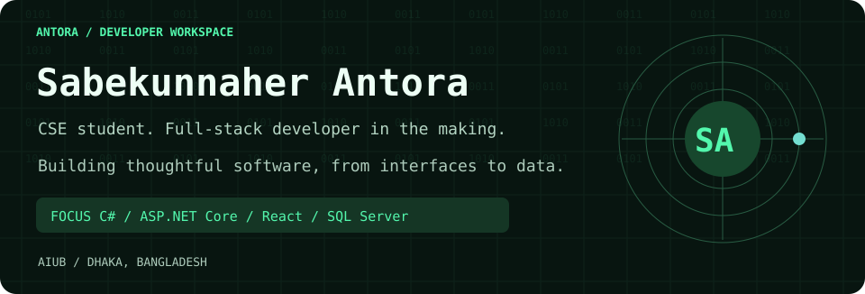
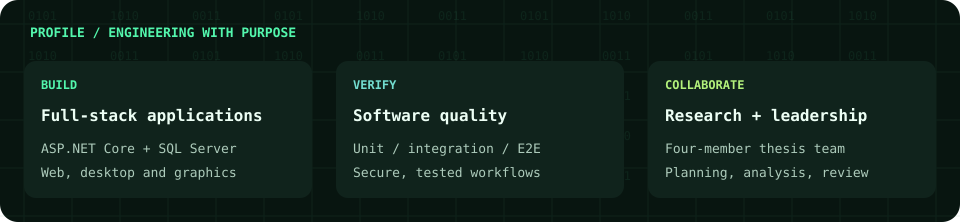
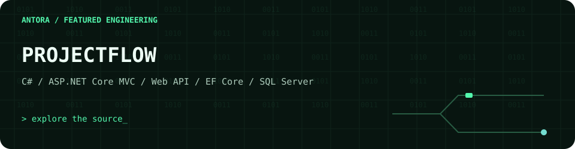
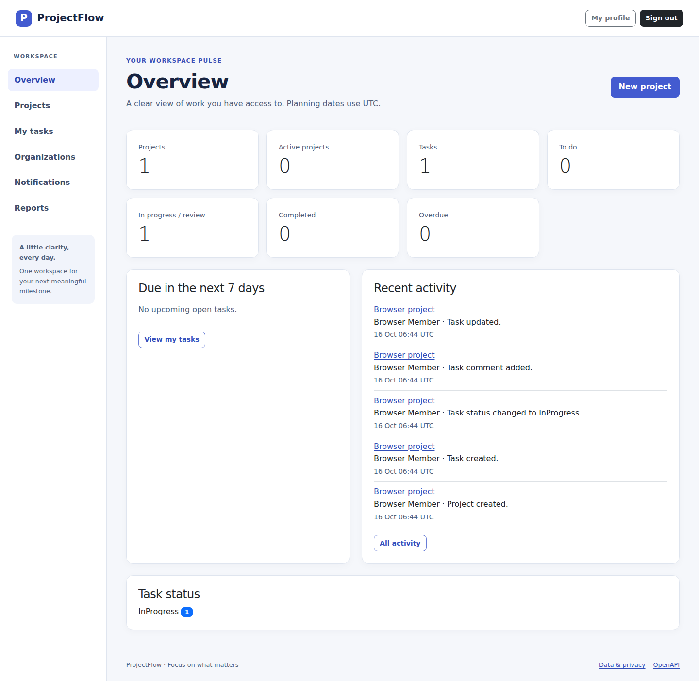
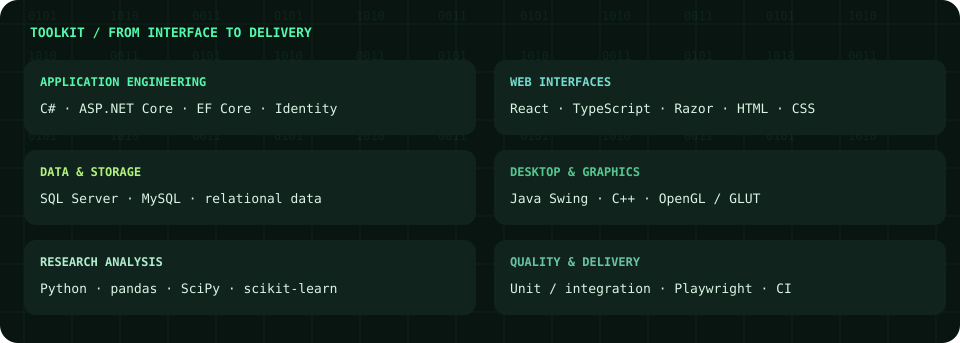
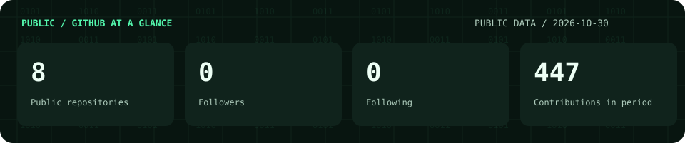
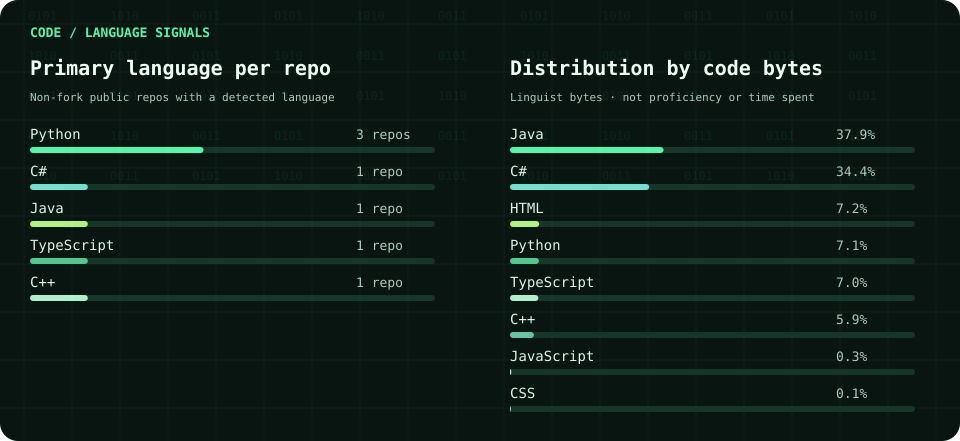
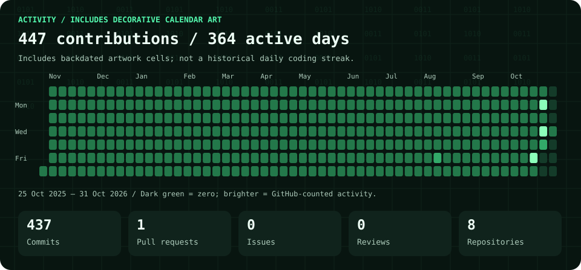

<picture>
  <source media="(prefers-reduced-motion: reduce) and (max-width: 600px)" srcset="assets/header-mobile-still.svg">
  <source media="(prefers-reduced-motion: reduce)" srcset="assets/header-still.svg">
  <source media="(max-width: 600px)" srcset="assets/header-mobile.svg">
  
</picture>

  <a href="https://sabekunnaher-17.github.io/"><strong>Portfolio</strong></a> &nbsp; / &nbsp;
  <a href="assets/Sabekunnaher_Antora_CV.pdf"><strong>Download CV</strong></a> &nbsp; / &nbsp;
  <a href="https://www.linkedin.com/in/sabekunnaher-antora17">LinkedIn</a> &nbsp; / &nbsp;
  <a href="mailto:antorasabekunnaher@gmail.com">Email</a>

I'm **Sabekunnaher Antora**, a **Computer Science and Engineering student at AIUB**, based in Dhaka, Bangladesh. I build full-stack applications with a focus on **ASP.NET Core, Entity Framework Core, SQL Server, and Java**. I care about secure application design, clear interfaces, and testing the flows people actually use.

I'm seeking opportunities to contribute in **software development, testing, and data analysis**. My work brings together web applications, desktop software, computer graphics, and academic research.

### Selected engineering work

#### 01 / [ProjectFlow](https://github.com/sabekunnaher-17/ProjectFlow)

<picture>
  <source media="(prefers-reduced-motion: reduce) and (max-width: 600px)" srcset="assets/projectflow-banner-mobile-still.svg">
  <source media="(prefers-reduced-motion: reduce)" srcset="assets/projectflow-banner-still.svg">
  <source media="(max-width: 600px)" srcset="assets/projectflow-banner-mobile.svg">
  
</picture>

**A project and task workspace built around organizations, people, and deadlines.**

- Layered architecture with shared services for MVC pages and the REST API; Kanban and table views for day-to-day task management.
- ASP.NET Core Identity roles, account lockout, IP limits, secure sessions, dashboards, reminders, notifications, comments, and CSV reports.
- Unit, integration, and Playwright browser tests, with SQL Server verification in GitHub Actions.

[Source & setup](https://github.com/sabekunnaher-17/ProjectFlow) · [Architecture](https://github.com/sabekunnaher-17/ProjectFlow/blob/main/docs/ARCHITECTURE.md) · [Testing](https://github.com/sabekunnaher-17/ProjectFlow/blob/main/docs/TESTING.md)

View the real ProjectFlow dashboard

#### 02 / [Hospital Appointment System](https://github.com/hospital-appointment-team/hospital-appointment-system) · organization project

<picture>
  <source media="(prefers-reduced-motion: reduce) and (max-width: 600px)" srcset="assets/organization-mobile-still.svg">
  <source media="(prefers-reduced-motion: reduce)" srcset="assets/organization-still.svg">
  <source media="(max-width: 600px)" srcset="assets/organization-mobile.svg">
  
</picture>

**PHP MVC · MySQL · HTML · CSS · JavaScript**

A team application for booking appointments by doctor and specialization, with patient, doctor, and administrator workflows. My [merged PR #2](https://github.com/hospital-appointment-team/hospital-appointment-system/pull/2) records my **appointment booking and dashboard** contribution. Authentication and doctor administration were contributed by a teammate. I collaborated in a four-member team using feature branches and pull requests.

[Organization](https://github.com/hospital-appointment-team) · [My merged contribution](https://github.com/hospital-appointment-team/hospital-appointment-system/pull/2) · [Project documentation](https://github.com/hospital-appointment-team/hospital-appointment-system/tree/main/docs)

#### 03 / [Q-Billiard Shop](https://github.com/sabekunnaher-17/Q-Billiard-Shop)

**Java · Swing · AWT · File handling**

An academic desktop shop with separate user and administrator screens, a billiard-equipment catalog, custom cue builder, and payment-method screens. User, administrator, and order data use Java file handling. Payment screens are interface demonstrations; no live payment processing is claimed.

#### 04 / [Solar System Simulation](https://github.com/sabekunnaher-17/Solar-System-Simulation)

**C++ · OpenGL · GLUT**

An interactive 3D graphics project with planetary orbits, camera perspectives, lighting, and a star field. The source also implements DDA lines, midpoint circles, and a Bézier comet path.

### Technical toolkit

The following toolkit is listed in my CV; the linked projects show selected technologies in practice.

| Area | Technologies |
| --- | --- |
| Languages | C#, Java, C++, Python, JavaScript, TypeScript, PHP, SQL, HTML, CSS |
| Backend | ASP.NET Core MVC & Web API, EF Core, ASP.NET Core Identity, .NET Framework, Node.js, NestJS, REST APIs |
| Frontend | React, Next.js, Razor, Tailwind CSS, Bootstrap 5 |
| Desktop | Java Swing |
| Databases | SQL Server / SSMS, MySQL, PostgreSQL, SQLite |
| Testing & delivery | Unit and integration testing, Playwright, pytest, Vitest, Git, GitHub, GitHub Actions |

### Research / from questions to evidence

**[Unnoticed Disclosure: Readers Do Not Register AI Source Labels on De-Influencing Content](https://github.com/sabekunnaher-17/Unnoticed-Disclosure-Readers-Do-Not-Register-AI)**

A four-member research project investigating AI disclosure labels, source recall, and consumer behavior. The recorded analysis reports **183 valid participants** and **50.8% source-label recognition**. Python analysis uses **pandas, SciPy, scikit-learn, and Matplotlib**; recorded cross-validation results include **R² = 0.578** for trust prediction and **AUC = 0.879** for anti-consumption classification.

I coordinated the thesis team's study planning, analysis tasks, and final-paper review. The repository contains the manuscript, script, and recorded results. The input response dataset is not public, so these are reported findings rather than an independently rerun analysis. No publication or acceptance status is claimed.

[Analysis code](https://github.com/sabekunnaher-17/Unnoticed-Disclosure-Readers-Do-Not-Register-AI/blob/main/src/analysis.py) · [Recorded results](https://github.com/sabekunnaher-17/Unnoticed-Disclosure-Readers-Do-Not-Register-AI/blob/main/results/results.txt)

### Education, leadership & learning

**American International University-Bangladesh (AIUB)** · Dhaka, Bangladesh

Bachelor of Science in Computer Science & Engineering — student

Coursework includes algorithms, databases, object-oriented programming, software engineering, computer networks, advanced .NET and web programming, and software quality assurance and testing.

- **Thesis Team Lead:** coordinated a four-member team, divided analysis work, planned the study, and reviewed the final paper.
- **Academic Project Lead:** organized .NET and web project tasks, tracked progress, and integrated teammates' work before submission.
- **Training:** AI Engineering Bootcamp — Ostad, 2025, as listed in my CV.

### GitHub / activity & code signals

Account activity totals include decorative calendar artwork. The contribution-calendar section below explains the dates and counting.

Contribution calendar, exact numbers &amp; methodology

**Activity disclosure:** My GitHub calendar and account totals include [decorative calendar artwork](https://github.com/sabekunnaher-17/contribution-calendar-art) with deliberately backdated author dates from October 25, 2025 through October 21, 2026. Those cells do not represent historical software development or a genuine daily coding streak.

<!-- snapshot:start -->
Public repositories: **7** · Followers: **0** · Following: **0**

Contribution period: **2025-10-25 → 2026-10-23**, inclusive. **445 contributions** across **363 active days**.

Commits: **436** · Pull requests: **1** · Issues: **0** · Reviews: **0** · Repository contributions: **7**.
<!-- snapshot:end -->

Source: GitHub REST and GraphQL APIs. Calendar dates are retained as returned by GitHub; query boundaries use Asia/Dhaka (+06:00). The current day is partial. Contribution categories follow GitHub eligibility rules and may not sum to the calendar total. Organization work is featured separately from personally owned repository metrics.

[Raw snapshot](data/github.json) · [Data and content provenance](docs/IMPLEMENTATION.md)

---

**Have a development, testing, or research opportunity?** [Email me](mailto:antorasabekunnaher@gmail.com), connect on [LinkedIn](https://www.linkedin.com/in/sabekunnaher-antora17), or explore my [portfolio](https://sabekunnaher-17.github.io/).

CV-aligned profile · repository-hosted visuals · reduced-motion support · daily GitHub data refresh. Project links lead to source and documentation; no project live demo has been verified.
